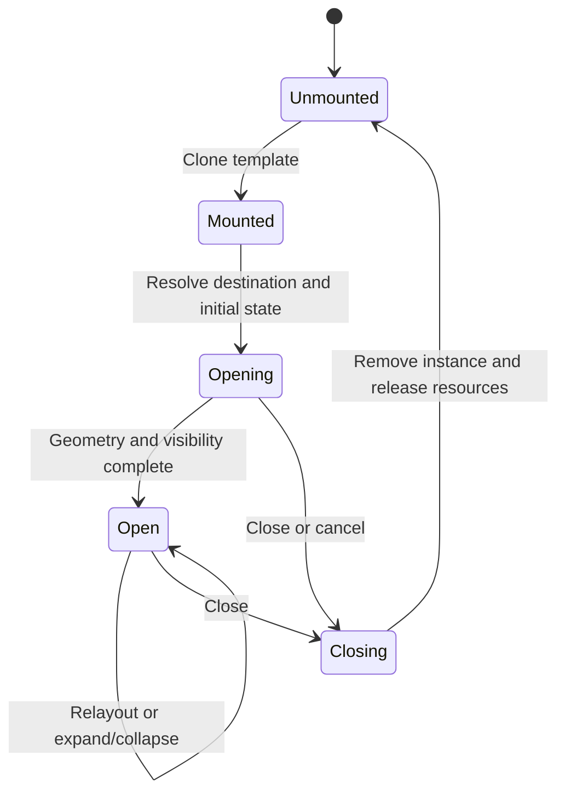

> Imported unchanged from the owner's draft (`iota-floating-viewports-spec.md`,
> v0.1, 2026-10-11). Under review: [decisions.md](decisions.md) — nothing here
> is ruled until that review is; the playground it cites was not inspected.

# Iota — Floating Viewports Specification

**Version:** 0.1 · Detailed draft  
**Date:** 11 October 2026  
**Context:** Reactogenic / Iota  
**Reference playground:** [Iota Viewport Lab](https://iota-viewport-lab.chicfly16.chatgpt.site)

## 1. Status and scope

This specification describes the floating viewport model developed in the discussion and explored in the seven-case playground. It covers rendering layers, anchors, placement-dependent axes, sizing, automatic expansion, space negotiation, modality, animation, templates, and lifecycle.

Requirements marked **Agreed** reflect the design established in the discussion. **Prototype policy** identifies a concrete playground choice that needs validation. **Proposed contract** makes an implementation detail explicit without claiming that its API or default has been approved. **Open** identifies a decision that remains unresolved.

The playground is evidence of behavior, not the final implementation contract. Its geometry and DOM-emulation checks pass; browser visual quality and animation performance have not been verified. The framework must not introduce a router or require page-controller machinery for these primitives.

## 2. Core model

### 2.1 Exactly two global rendering layers — Agreed

The page has two global layers:

1. `BaseLayer`: contains normal page presentation and the base viewport.
2. `StackingLayer`: sits above the base layer and globally contains every floating viewport.

```html
<main class="base-layer">
  <div class="base-viewport">
    <button type="button">Open Sidebar</button>
  </div>
</main>
<div class="stacking-layer"></div>
```

The word “layer” denotes these two global rendering surfaces. A floating child can establish its own CSS stacking context without becoming a third global layer.

A floating viewport must be a direct sibling of other floating viewports in `StackingLayer`, including when its trigger is inside another floating viewport. Logical ownership does not imply nested rendering ownership.

### 2.2 CSS stacking contract — Agreed

```css
.base-layer {
  position: relative;
  z-index: 0;
}

.stacking-layer {
  position: fixed;
  inset: 0;
  z-index: 1;
  pointer-events: none;
}

.stacking-layer > .floating-viewport {
  position: absolute;
  z-index: 0;
  pointer-events: auto;
}
```

Each positioned floating root establishes a stacking context at `z-index: 0`. Later siblings paint above earlier siblings. Descendants stay within their root’s stacking context; a high descendant `z-index` cannot overtake a later floating root.

The unused part of the stacking layer lets pointer interaction reach the base. Modality is enforced with `inert`, independently of this pointer-routing rule.

Native browser top-layer mechanisms, including modal `dialog` presentation and native popover presentation, are excluded from this model. Presentation must remain under the floating stack’s ordering.

### 2.3 Runtime responsibilities

| Primitive | Responsibility |
| --- | --- |
| `BaseViewport` | Own normal content bounds and decide whether requested space can be reserved. |
| `StackingLayer` | Own floating root mounting, paint order, stack lifecycle, and modal blocking relationships. |
| `FloatingElement` | Own content and intrinsic behavior, such as a menu, sidebar, or expanding button. |
| `FloatingElement.Viewport` | Own the defined rectangular area the element fills: anchor, intended size, effective placement, expansion, and animation geometry. |

These primitives have JavaScript interfaces. Their responsibilities must remain distinct even if an implementation combines some objects internally. The viewport is a defined area; “fixed area” does not require every floating child to use CSS `position: fixed`.

## 3. Geometry vocabulary

### 3.1 Four distinct inputs

| Term | Meaning |
| --- | --- |
| Parent viewport | Area against which filling thresholds and full-axis bounds are evaluated; commonly the window. |
| Anchor reference | `HTMLElement` whose rectangle supplies inset or outset anchor geometry. |
| Trigger | Optional element that initiates the interaction and can supply Scale-Up’s starting rectangle. |
| Floating viewport | Resolved rectangle occupied by the floating element. |

A trigger and anchor reference may be the same element, but they are not interchangeable concepts. A trigger can be absent while an anchor remains defined. A trigger can be inside the viewport it controls.

For a window-relative inset anchor, the runtime needs a parent-reference adapter that represents the visible window rectangle. It must not accidentally substitute the full scrollable document’s dimensions. The precise public representation of this adapter is **Open**.

### 3.2 Main and cross — Agreed

Public offsets and floating sizing behavior use `main` and `cross`. Physical `x`, `y`, `width`, and `height` are implementation details used for DOM measurement and rendering.

```ts
type AxisPair<T> = { main: T; cross: T };
type Offset = AxisPair<number>;
```

Offsets are two-dimensional. A consumer does not need another coordinate-system object to interpret them: the effective anchor placement defines the axes and directions.

Numeric lengths below are CSS pixels. Percentages refer to size ratios unless explicitly named as animation scale percentages.

## 4. Inset anchors

### 4.1 Nine placements and axis mapping — Agreed

Inset anchors match the same point of the reference and floating viewport, then apply offsets. Placement names follow the `main-cross` concept, with shorthand names for centered cross alignment.

| Placement | Matched point | Main axis | Cross axis | Positive main | Positive cross |
| --- | --- | --- | --- | --- | --- |
| `top-left` | Top-left | Vertical | Horizontal | Down | Right |
| `top` / `top-center` | Top-center | Vertical | Horizontal | Down | Right |
| `top-right` | Top-right | Vertical | Horizontal | Down | Left |
| `left` / `left-center` | Left-center | Horizontal | Vertical | Right | Down |
| `center` / `center-center` | Center | Horizontal | Vertical | Right | Down |
| `right` / `right-center` | Right-center | Horizontal | Vertical | Left | Down |
| `bottom-left` | Bottom-left | Vertical | Horizontal | Up | Right |
| `bottom` / `bottom-center` | Bottom-center | Vertical | Horizontal | Up | Right |
| `bottom-right` | Bottom-right | Vertical | Horizontal | Up | Left |

Right and bottom edge offsets are inverted. A positive offset moves inward toward the reference center along an edge-anchored axis. Negative values reverse the direction. On a centered axis there is no inward edge direction; the draft retains positive right/down behavior, as implemented in the playground (**Prototype policy**).

Thus a `bottom-right` viewport with `{ main: 4, cross: 8 }` ends 4px above the reference’s bottom edge and 8px left of its right edge.

### 4.2 Point-to-point calculation

Let the reference rectangle be `(rx, ry, rw, rh)` and floating dimensions be `(fw, fh)`. Let anchor fractions `(ax, ay)` each be `0`, `0.5`, or `1`.

```text
originX = rx + rw × ax
originY = ry + rh × ay

unoffsetLeft = originX − fw × ax
unoffsetTop  = originY − fh × ay
```

Map `main` and `cross` to physical offsets according to the table. Multiply the horizontal offset by `−1` when `ax = 1`; multiply the vertical offset by `−1` when `ay = 1`. Add the resulting offsets to the unoffset position.

The **offset origin** is the matched reference point before applying the offset. The floating anchor point after displacement is distinct from that origin. This distinction determines Slide reflection and triggerless Scale-Up.

## 5. Outset anchors

### 5.1 Twelve placements — Agreed

Outset anchors place the viewport outside one of four reference edges, with three cross alignments per edge:

| Edge | Placements | Main axis | Cross axis |
| --- | --- | --- | --- |
| Top | `top-start`, `top`, `top-end` | Vertical | Horizontal |
| Bottom | `bottom-start`, `bottom`, `bottom-end` | Vertical | Horizontal |
| Left | `left-start`, `left`, `left-end` | Horizontal | Vertical |
| Right | `right-start`, `right`, `right-end` | Horizontal | Vertical |

Positive outset `main` moves away from the selected edge. Cross-axis alignment and offsets are adapted to Floating UI’s placement semantics. The inward right/bottom correction in §4 applies to inset anchoring; it does not reverse an outset gutter.

The initial physical conventions are those explored in the playground. RTL and non-horizontal writing modes need an explicit mapping policy before being declared supported (**Open**).

### 5.2 Trigger cross-dimension matching — Agreed

Cross matching is a sizing policy, not an additional placement:

- Top/bottom outset: floating cross extent matches the reference width.
- Left/right outset: floating cross extent matches the reference height.

With zero cross offset and no collision correction, the reference and floating cross spans coincide. The main extent remains independent. If automatic placement switches axes, matching must be recalculated for the effective placement.

The playground uses the same element as reference and trigger. If they differ, whether “match trigger” should follow the trigger or anchor reference is **Open**; the public contract must name the source rather than silently equate them.

### 5.3 Collision detection and automatic outset position — Agreed

Borrow Floating UI’s researched collision detection and outset position resolution. Iota remains responsible for inset geometry, expansion, reservations, modality, and animation.

The placement adapter must distinguish two strategies:

| Strategy | Behavior |
| --- | --- |
| Preferred with fallback | Retain the requested placement when it fits; use Floating UI `flip()` to resolve a fallback. |
| Automatic | Use Floating UI `autoPlacement()` to choose among permitted placements according to available space. |

`flip()` and `autoPlacement()` are alternatives, not simultaneous middleware. See the official [flip](https://floating-ui.com/docs/flip), [autoPlacement](https://floating-ui.com/docs/autoplacement), and [detectOverflow](https://floating-ui.com/docs/detectoverflow) documentation.

Collision boundaries must correspond to the intended parent/clipping region, not accidentally to an unrelated ancestor. Collision detection does not itself imply a base-space request.

The playground also uses shifting to keep outset views in bounds. Whether shifting, fallback candidates, boundary padding, and alignment fallback should be fixed system policy or exposed options is **Open**. Floating UI’s complete middleware API is not automatically Iota’s public API.

## 6. Intended size and effective size

### 6.1 Separate the two — Agreed

**Intended anchored size** is the size the viewport would use before expansion, collision-driven constraints, or reservation allocation. **Effective size** is the size committed for rendering.

Intended size may come from explicit axis extents, measured content, parent-relative sizing, or trigger/reference cross matching. The final content-sizing API is **Open**. The prototype predominantly uses explicit extents.

The runtime must retain intended size independently. Measuring an expanded rectangle and using it as the next intended size would lock the viewport in expansion. Measuring intermediate animation geometry as intended size would introduce feedback and unstable thresholds.

### 6.2 Independent axis expansion — Agreed

```ts
fillMain  = intended.main  / parent.main  >= threshold.main;
fillCross = intended.cross / parent.cross >= threshold.cross;
```

Thresholds are interpreted on the effective placement’s axes. The `>=` equality boundary is a **Proposed contract** matching the prototype; the discussion specified exceeding a threshold without settling equality.

| Main fills | Cross fills | Result |
| --- | --- | --- |
| No | No | Both axes retain anchored geometry. |
| Yes | No | Main spans the parent; cross remains independently positioned. |
| No | Yes | Cross spans the parent; main remains independently positioned. |
| Yes | Yes | Viewport fills the parent rectangle. |

A filled axis overrides that axis’s anchor alignment and offset. The other axis continues to follow the effective anchor policy. Shrinking intended size or enlarging the parent can restore anchored geometry.

Expansion is applicable to both inset and outset viewports. An outset viewport that expands abandons outset anchoring for an effective inset mode. Its requested outset anchor remains stored for restoration.

### 6.3 Outset-to-inset mapping — Prototype policy

The exact inset fallback is not yet an agreed nine-point mapping. The playground uses:

| Requested outset | Expanded inset |
| --- | --- |
| `top-start`, `top`, `top-end` | `top-left`, `top`, `top-right` |
| `bottom-start`, `bottom`, `bottom-end` | `bottom-left`, `bottom`, `bottom-right` |
| Left placements | `left` |
| Right placements | `right` |

The parent replaces the original reference for expanded placement. Left/right cross alignment is therefore not fully preserved in the prototype. This mapping must be reviewed before release.

A placement change must remap axes, intended extents, matching, offsets, and thresholds consistently. The runtime must settle the expansion/placement decision before starting an entrance animation. It must avoid an unbounded loop between fallback placement and expansion.

### 6.4 Measurement boundary — Proposed contract

Use an explicit parent rectangle per layout transaction. If the rectangle has zero extent on an evaluated axis, defer resolution instead of dividing by zero. Disabled thresholds should have a semantic disabled representation in the API; internal `Infinity` is an implementation convenience.

Threshold hysteresis, when to constrain oversized content, and whether window bounds track the layout or visual viewport during keyboard appearance are **Open**. They must not be inferred from the prototype’s numeric defaults.

## 7. Base-space negotiation

### 7.1 Eligible placements — Agreed

Only edge-centered inset viewports have the special ability to request base space:

| Placement | Requested main extent | Base margin affected |
| --- | --- | --- |
| `top` | Height internally | Top |
| `right` | Width internally | Right |
| `bottom` | Height internally | Bottom |
| `left` | Width internally | Left |

Corners and center do not obtain reservation powers merely because they are inset. An outset viewport cannot request a reservation while it remains effectively outset. Whether an expanded outset becomes eligible automatically is **Open**; explicit eligibility should not be inferred from expansion alone.

### 7.2 Request and decision — Agreed

The floating viewport requests its main extent. `BaseViewport` decides whether granting it would preserve its own sizing policy, such as minimum width or height.

- **Granted:** add the reservation to the corresponding base margin and place the panel in its allocated area.
- **Declined:** keep the base area and render the floating viewport over it.

A reservation never changes DOM ownership. Granted panels remain in `StackingLayer`. Modality, paint order, and reservation are independent properties.

Existing base margins are preserved. The baseline experiment uses `3dvmin` on the outer viewport; reservations add to those margins rather than replacing them.

### 7.3 Competing sides and the shared corner — Agreed starting policy

Resolve accepted requests in stable reservation-opening order. The earlier accepted request receives its strip from the available rectangle; later requests use the remaining rectangle.

For an `800 × 600` parent, a 200px left panel, and a 150px bottom panel:

| Opening order | Left allocation | Bottom allocation | Remaining rectangle |
| --- | --- | --- | --- |
| Left, then bottom | `200 × 600` | `600 × 150`, to the right of left | `600 × 450` |
| Bottom, then left | `200 × 450`, above bottom | `800 × 150` | `600 × 450` |

The first reservation owns the shared corner. The base has the same remaining rectangle in this example, but the panel shapes differ.

This interaction-order dependency is a known inconsistency to monitor. A fixed edge-priority policy could replace it later if users find it surprising. The specification does not adopt such a replacement now.

Reservation order and paint order are separate concepts. If future paint reordering is supported, bringing a panel forward must not silently alter reservation precedence.

### 7.4 Minimum-size accounting — Proposed contract

Evaluate each candidate against the parent rectangle minus already accepted reservations and the base’s own margins. Do not start from the base’s already-shrunken rendered rectangle and subtract the same reservations again.

For a horizontal reservation:

```text
remainingHorizontal − requestedMain − baseHorizontalMargins
    >= baseMinimumHorizontal
```

Use the analogous vertical condition for top/bottom. The prototype grants the full request or declines it; it does not partially shrink a panel to make a request fit.

Reevaluate requests in their stable opening order when the parent, intended panel size, or base sizing policy changes. A grant may become an overlay and vice versa. This reevaluation is separate from incremental modal inertness bookkeeping.

**Open:** whether a panel’s inset offset is included as a reservation gap. The current prototype allocates the requested extent and uses zero offset inside the granted strip. A final contract must distinguish panel extent from total reserved span if gaps are supported.

### 7.5 Reservation lifetime — Prototype policy

Acquire the reservation when the opening transaction resolves final geometry. Retain it through the exit animation and release it when the floating root is removed. Closing one reservation causes later requests to be reevaluated.

This avoids switching from reserved to overlay partway through exit, but can produce a visible base transition. The timing and animation of that transition remain **Open**.

## 8. Modality and interaction

### 8.1 One ordered stack — Agreed

A floating viewport is modal or non-modal. The topmost modal defines the active interaction boundary:

- The base viewport is inert.
- Floating entries below that modal are inert.
- The modal and entries above it remain interactive.

A non-modal popup above the modal therefore works without a third layer. A non-modal entry below the modal remains blocked. Position, size, and reservation status do not affect this rule.

### 8.2 Incremental claims — Agreed under stack discipline

No separate modal stack or full boundary scan is required for normal LIFO mounting and unmounting.

When pushing a modal:

1. Record the base and all existing floating entries as its blocked targets.
2. Add one inertness claim to each target.
3. Append the modal above those targets.

When popping that modal, remove exactly the claims it added. A target remains inert while any claim remains.

```text
systemBlocked(target) = claimCount(target) > 0
```

Example:

| Operation | Base claims | Modal A claims | Modal B claims |
| --- | --- | --- | --- |
| Open A | 1 | 0 | — |
| Open B | 2 | 1 | 0 |
| Close B | 1 | 0 | — |
| Close A | 0 | — | — |

A boolean alone is insufficient for nested modals. Releasing one modal’s claim must not reactivate a target still blocked by another.

Preserve preexisting inertness. The runtime removes its own claims; it does not indiscriminately clear application-owned `inert` state. Claim acquisition and release must be idempotent for repeated close/dispose calls.

### 8.3 Non-LIFO operations — Prototype policy and Open

The playground maintains LIFO removal: closing a lower entry also closes entries above it. This preserves the simple claim model but may close unrelated floating views. That cascade is not an agreed production behavior.

Arbitrary removal, reordering, and changing `modal` while mounted require additional bookkeeping or a restricted API. They must not be exposed while retaining assumptions that only hold under LIFO operation.

### 8.4 Focus and accessibility — Proposed contract

Modality must manage keyboard interaction as well as pointer interaction:

- Capture a return-focus target before applying the new modal claims.
- Move focus into the active modal when it becomes usable.
- Keep Tab navigation within the active modal and eligible interactive floating entries above it.
- Do not allow focus to remain in an inert base or lower floating entry.
- On close, restore an available, connected, non-inert target; otherwise use a defined fallback within the remaining active region.

Only the currently active modal should advertise active modal semantics. Content components choose their correct roles and accessible names; a generic floating viewport is not automatically a menu or dialog.

The prototype uses Escape to close the top entry, and to collapse the expanded self-trigger viewport. Outside-click dismissal, mandatory versus dismissible modals, focus-entry timing, fallback focus, and inclusion of unrelated entries above the modal are **Open** policies.

## 9. Animation model

### 9.1 Three steps — Agreed

| Step | Responsibility | Ordering |
| --- | --- | --- |
| A | Render the initial viewport geometry. | Before transitions start. |
| B | Transition viewport geometry into its resolved destination. | Runs concurrently with C. |
| C | Change viewport content visibility. | Runs concurrently with B. |

Resolve collision placement, axis expansion, and reservation allocation before computing A. Do not animate toward a provisional rectangle and correct it only after entrance finishes.

Step A must be committed as a genuine starting state. The implementation may use explicit animation keyframes or a frame-separated style transition. The contract does not require a particular CSS or Web Animations API mechanism.

The content visibility transition must not determine the viewport’s intended size. Its subtree remains mounted and measurable where necessary.

### 9.2 Scale-Up with a trigger — Agreed

The initial viewport rectangle takes the trigger’s position and dimensions. B transitions that rectangle to the destination rectangle. C changes content visibility concurrently.

Different trigger and destination aspect ratios are allowed: “Scale-Up” describes the viewport geometry transition, not necessarily a uniform CSS transform applied to all content. Content should not accidentally inherit text distortion merely because the container’s geometry changes.

The trigger rectangle must be sampled before changing state that would move or resize that same trigger.

### 9.3 Scale-Up without a trigger — Agreed

Use a configurable initial scale `N%` of the final viewport’s dimensions. Keep its own offset anchor point fixed during the growth.

Let final rectangle be `(x, y, w, h)`, anchor fractions `(ax, ay)`, and `s = N / 100`:

```text
initialWidth  = w × s
initialHeight = h × s
initialLeft   = x + (w − initialWidth) × ax
initialTop    = y + (h − initialHeight) × ay
```

For `bottom-right`, the final bottom-right point remains fixed; for `center`, the center remains fixed. This pivot includes the applied offset, rather than using the unoffset reference point.

The playground uses 30% in several cases. No universal default has been agreed. The final API must validate finite scale values and decide whether zero is permitted instead of silently choosing an arbitrary clamp (**Open**).

### 9.4 Slide — Agreed

Slide changes position only along the main axis. Cross position and both dimensions remain at final values.

Reflect the entire final main-axis interval across the offset origin. This reflects the offset as well as the viewport’s extent.

If the final interval begins at `p`, has extent `L`, and offset origin is `o`:

```text
initialMainStart = 2 × o − (p + L)
finalMainStart   = p
```

Examples relative to the parent’s origin:

| Placement | Parent main extent | Floating main extent | Positive offset | Final start | Initial start |
| --- | --- | --- | --- | --- | --- |
| Left | 800 | 300 | 4 | 4 | −304 |
| Right | 800 | 300 | 4 | 496 | 804 |
| Top | 600 | 200 | 4 | 4 | −204 |
| Bottom | 600 | 200 | 4 | 396 | 604 |

The right and bottom examples use corrected inward offsets. No cross-axis reflection or diagonal movement occurs.

`center` / `center-center` cannot Slide. Reject that configuration or require an explicit fallback. The playground switches its control to Scale-Up; that UI behavior is a prototype policy, not an automatic runtime requirement.

### 9.5 Closing and interruption — Prototype policy

The playground reverses geometry toward an initial-like rectangle and fades content during close. If the trigger still exists, its current rectangle can be the exit target. These closing semantics were not settled in the original three-step entrance model.

It serializes mount/unmount actions and retargets geometry when layout changes during an animation. A final runtime should define cancellation and completion promises explicitly: a cancelled operation must not later report a successful entrance or apply stale geometry.

Reduced-motion support should commit the same layout and interaction result with minimal motion (**Proposed contract**). Exact durations, easings, visibility properties, whether B and C share a duration, and immediate reversal on repeated user input are **Open**.

## 10. Trigger inside its own viewport

### 10.1 Required seventh scenario — Agreed

An expanding/collapsing floating button has its trigger inside the viewport it controls.

- Collapsed: viewport contains the compact button area.
- Expanding: sample that button’s rectangle, then transition to the expanded destination.
- Expanded: the button remains a descendant and can collapse the viewport.
- Collapsing: return to compact geometry without remounting the trigger.

The trigger’s identity must survive toggles. Local state in the mounted content must survive geometry changes unless the content component deliberately resets it. Collapse and unmount are different operations.

The button can remain visible while other content follows C. “Change content visibility” must not require hiding the control that permits reversal.

### 10.2 Avoid self-measurement feedback — Proposed contract

Keep collapsed size and intended expanded size separately. Do not derive the next intended expanded size from the currently animated outer rectangle.

If expanded geometry fills an axis, apply the same expansion rules as any other floating viewport. If that moves the trigger’s effective position, calculate collapse against the intended compact destination and define how it relates to the current trigger rectangle. The prototype’s 56px compact size and bottom-right placement are example values, not framework constraints.

## 11. Templates and resource lifecycle

### 11.1 Template-driven mounting — Agreed

Mount floating elements by cloning `<template>` content. Unmount by removing the mounted instance; preserve the template itself.

```html
<template id="sidebar-template">
  <section class="floating-viewport">
    <div class="floating-element">
      <button type="button" data-action="close">Close</button>
      <!-- Component content -->
    </div>
  </section>
</template>
```

The runtime registers the cloned root in the stack. It may bind behavior using delegation or per-instance listeners. Public mounting rules should validate the expected root structure and prevent duplicate document IDs when templates are cloned multiple times.

A geometry update, expansion, reservation change, or self-trigger collapse must not require replacing the template instance.

### 11.2 Lifecycle — Proposed contract



Before opening, register the instance, resolve final geometry, acquire applicable reservations and modal claims, and establish initial rendering state. Precisely when a registered but hidden instance becomes interactive is **Open**.

On unmount, cancel active animations, disconnect instance observers, release owned subscriptions/listeners, invalidate pending layout results, release reservations and modal claims exactly once, remove the cloned root, and restore eligible focus.

The page lifecycle must dispose the stack and base runtime. Persistent references to removed triggers, template clones, and animation closures must not retain a completed page indefinitely.

## 12. Proposed JavaScript interface

The following is a semantic API sketch, not the playground’s exact implementation or a finalized export surface.

```ts
type InsetPlacement =
  | 'top-left' | 'top' | 'top-right'
  | 'left' | 'center' | 'right'
  | 'bottom-left' | 'bottom' | 'bottom-right';

type OutsetPlacement =
  | 'top-start' | 'top' | 'top-end'
  | 'right-start' | 'right' | 'right-end'
  | 'bottom-start' | 'bottom' | 'bottom-end'
  | 'left-start' | 'left' | 'left-end';

type Anchor =
  | {
      type: 'inset';
      reference: HTMLElement;
      placement: InsetPlacement;
      offset: Offset;
    }
  | {
      type: 'outset';
      reference: HTMLElement;
      placement: OutsetPlacement;
      offset: Offset;
      positionPolicy: 'preferred' | 'auto';
    };

type Animation =
  | { type: 'scale-up'; initialScalePercent: number }
  | { type: 'slide' };

type FloatingViewportOptions = {
  anchor: Anchor;
  parent: Window | HTMLElement;
  trigger?: HTMLElement;
  intendedSize: AxisPair<number>;
  fillThreshold: AxisPair<number | null>; // ratios; null disables an axis
  crossSizing: 'independent' | 'match-reference';
  modal: boolean;
  requestBaseSpace: boolean;
  animation: Animation;
};

type ResolvedViewportState = {
  requestedAnchor: Anchor;
  effectiveMode: 'inset' | 'outset';
  effectivePlacement: InsetPlacement | OutsetPlacement;
  fill: AxisPair<boolean>;
  reservation: 'none' | 'granted' | 'declined';
  interaction: 'active' | 'inert';
  lifecycle: 'mounted' | 'opening' | 'open' | 'closing' | 'unmounted';
};

interface FloatingViewportHandle {
  readonly element: HTMLElement;
  readonly state: ResolvedViewportState;
  open(): Promise<void>;
  update(options: Partial<FloatingViewportOptions>): Promise<void>;
  close(): Promise<void>;
  dispose(): void;
}

interface SpaceRequest {
  viewport: FloatingViewportHandle;
  side: 'top' | 'right' | 'bottom' | 'left';
  mainExtent: number;
}

interface BaseViewportInterface {
  readonly element: HTMLElement;
  requestSpace(request: SpaceRequest): 'granted' | 'declined';
  releaseSpace(viewport: FloatingViewportHandle): void;
}

interface StackingLayerInterface {
  readonly element: HTMLElement;
  readonly entries: readonly FloatingViewportHandle[];
  mount(template: HTMLTemplateElement,
        options: FloatingViewportOptions): FloatingViewportHandle;
  dispose(): void;
}
```

An outset anchor always requires its reference, even when no separate trigger exists. A window anchor adapter, intrinsic content sizing, reservation tokens, operation cancellation results, and typing invalid combinations are not represented fully in this sketch.

Validate center+Slide, nonfinite sizes/offsets, invalid thresholds, invalid reservation eligibility, and unsupported mounted modal changes. Do not silently expose arbitrary stack reorder through `update()`.

Read-only diagnostics should distinguish requested configuration from effective state. Modality, expansion, and reservation are independent state dimensions rather than a single combined “mode” enum.

## 13. Layout transaction — Proposed contract

1. Snapshot parent and relevant reference geometry in one coordinate space.
2. Resolve intended axis sizes, including reference cross matching.
3. Evaluate expansion against the parent’s stable available extent.
4. If effectively outset, resolve collision placement with Floating UI; remap axes and matching if placement changes, then settle expansion again with a bounded resolution process.
5. Resolve the effective inset fallback when required.
6. Evaluate eligible base reservations in stable opening order.
7. Commit the base margins and final floating rectangles consistently.
8. For entrance, derive A from the settled destination and run B/C concurrently. For relayout, commit or retarget according to the lifecycle policy.
9. Publish diagnostic state and notify affected content only after a consistent result is available.

Batch invalidations within a frame. Reject stale asynchronous results using a transaction generation or equivalent ownership check. Updating layout must not repeatedly reacquire modal claims.

Relevant invalidations include parent resizing, reference movement/resizing, scrolling, intended content-size changes, base policy changes, stack changes, and configuration updates. Watching only browser `resize` is insufficient when an anchor moves inside a resized or scrolling floating owner.

**Open:** transformed references, zoom, nested clipping regions, logical writing directions, and the exact window viewport definition. The prototype primarily uses ordinary physical rectangles inside a clipped lab canvas.

## 14. Acceptance criteria

| Case | Required observations |
| --- | --- |
| 1. Outset + collision | Requested placement fits when possible; fallback occurs at a boundary; cross matching tracks the selected source and remaps on axis changes. |
| 2. Reserve / overlay | Sidebar remains in the stack in both states; base minimum policy decides the grant; resize can change the decision without remounting content. |
| 3. Shared corner | Left-first and bottom-first produce the specified different strips; accepted strips do not overlap; base sizing policy remains satisfied. |
| 4. Modal boundary | Base and lower entries are inert; active modal and higher popup work; nested close releases only owned claims; focus does not enter blocked content. |
| 5. Axis expansion | Main-only, cross-only, both, and neither are reachable; outset can become inset and restore; expanded geometry never supplies its own threshold input. |
| 6. Motion | Step A is visible as the starting geometry; B/C run concurrently; Slide changes only main position; left/right/top/bottom offsets reflect correctly; center rejects Slide; triggerless scale keeps its pivot. |
| 7. Self-trigger | Trigger is inside its own viewport; expansion starts from its sampled rectangle; collapse preserves trigger identity and local input state; full unmount removes the clone. |

Additional checks:

- All nine inset anchor points align correctly before offsets.
- Positive right/bottom offsets move inward, including corner cross offsets; negative values reverse them.
- Every floating root is a direct stack sibling with `z-index: 0`.
- Nested modal claims never become negative and double disposal is harmless.
- Application-owned inertness survives system claim release.
- Reservations are based on stable available bounds, not compounded rendered margins.
- Parent changes during entrance cannot commit a stale destination.
- Closing and page disposal release observers, pending animations, and ownership references.
- Reduced-motion behavior produces the same final geometry and interaction state.
- No implicit native top-layer presentation is used.

## 15. Benchmarking and verification

Continue benchmarking layout choices, but report the tested structure and metric. The earlier experiment concerned nesting depth, not total page element count. Its browser-specific observations do not establish a universal Flexbox/Grid performance ordering.

Separate DOM construction, synchronous style/layout, paint, animation smoothness, and complete interaction latency. Do not describe a forced-layout timing as total render time. Record browser/device, parent dimensions, depth, sample count, ordering, and any clipping or overflow stress conditions.

For this runtime, benchmark repeated mount/unmount, reservation relayout, reference tracking, nested modal push/pop, and animation interruption. Verification should include browser rendering and keyboard interaction in addition to pure geometry and DOM-emulation tests.

## 16. Decisions remaining before a production contract

> Ruled by the owner (2026-10-11): all fourteen rows —
> [decisions.md](decisions.md), *The draft's §16, ruled*. The sections above
> read as drafted until the second draft.

| Topic | Current draft or prototype | Decision needed |
| --- | --- | --- |
| Centered-axis offsets | Positive right/down | Confirm this convention. |
| Expansion boundary | `>=` | Confirm equality and any hysteresis. |
| Expanded outset mapping | Parent inset edge; left/right alignment simplified | Define complete alignment preservation and axis remapping. |
| Reservation order | First accepted request wins | Monitor interaction-order inconsistency. |
| Reservation gaps | Offsets ignored inside granted strips | Define requested extent versus total reserved span. |
| Grant lifetime | Release after exit | Confirm base transition timing. |
| Stack removal | LIFO cascade | Decide how unrelated or non-top entries can close. |
| Modal mutation / reorder | Restricted by assumptions | Define supported operations and claim updates. |
| Collision correction | Flip/auto and prototype shift | Define fixed system policy and exposed options. |
| Scale fallback | Configurable; examples use 30% | Define default, allowed range, and zero behavior. |
| Exit / reversal | Prototype reverse and serialized actions | Define interruption, cancellation, and promise results. |
| Focus / dismissal | Prototype Tab boundary and Escape | Define accessibility and dismissal contracts. |
| Reference loss | Close on next layout update in prototype | Define observation, timing, and dependent-owner behavior. |
| Window / writing modes | Lab canvas and physical geometry | Define visual viewport, keyboard, RTL, transforms, and zoom support. |

These decisions refine the existing primitives. They do not require additional global rendering layers or an x/y-based public offset abstraction.
